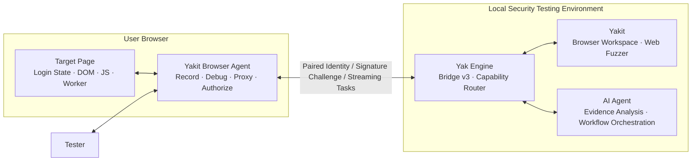

<p align="center">
  
</p>

<h1 align="center">Yakit Browser Agent</h1>

<p align="center">
  Security Testing and AI Agent Collaboration Extension for Real Browser Contexts
</p>

<p align="center">
  Connects the browser, Yak Engine, and Yakit, transforming login states, page functions, frontend encryption/decryption, network requests, and manual operations into authorized, reusable, and auditable testing capabilities.
</p>

> [!IMPORTANT]
> Yakit Browser Agent is designed for authorized security testing, enterprise self-testing, and educational environments. The extension possesses high-privilege capabilities such as reading login states, capturing network requests, invoking page functions, and debugging page execution contexts; please strictly use it only on targets you own or are explicitly authorized to test.

## Project Positioning

Yakit Browser Agent is the browser execution endpoint within the Yak / Yakit ecosystem. It runs inside the user's actual browser. Following explicit user authorization, it provides the page context, security testing capabilities, and human interaction capabilities of specific tabs to the Yak Engine, Yakit workspace, and AI Agents.

It focuses on solving several types of problems that traditional security testing tools struggle to handle naturally:

- Target functionality relies on an already logged-in browser environment and cannot be reproduced solely by offline HTTP requests;
- Request parameters are generated on-the-fly by obfuscated frontend code, closure states, dynamic keys, CryptoKey, Workers, or WebAssembly;
- Testers want to edit plaintext, but the target server only accepts ciphertext, signatures, or dynamic request encapsulation generated by the page;
- Workflows include steps that require user participation, such as QR code scanning, MFA, CAPTCHA, or device confirmation;
- Dual-identity authorization testing requires reliable isolation of login states, reuse of real requests, and retention of verifiable evidence;
- AI Agents require the browser to provide a real, structured, and controlled context, rather than relying on guessing from screenshots or exporting entire browser configurations.

This project is not merely an encryption/decryption script written for a specific cyber range, nor is it a simple JS-RPC forwarder. It is built on a foundation of universal calling evidence, business Traces, request boundaries, page Callables, and typed Pipelines: steps that can be completed with deterministic evidence are handled by code verification, while parts with insufficient evidence or complex semantics are handed over to user and AI-assisted analysis.

## Design Principles

| Principle | Description |
| --- | --- |
| Real Context First | Reuses functions, receivers, closures, and browser states currently running on the page, without requiring keys or complete algorithms to be exported externally first. |
| Evidence-Driven | Establishes conclusions through value fingerprints, invocation sequences, business Traces, request field correlations, and response attribution, instead of directly guessing conversion logic just because a "certain encryption library was found." |
| Explicit User Authorization | All remote capabilities are bound to specific tabs, Frames, documents, origins, tasks, permission scopes, and validities. Authorization is visible, pausable, and revocable. |
| Deterministic Verification & AI Collaboration | AI is used for explanation, summarization, and proposing solutions; protocol validation, Profile compilation, real replay, and result comparison are performed by deterministic code. |
| Universal Capabilities First | Establishes adaptation layers for libraries, algorithms, and business forms, rather than basing product logic on fixed field names, fixed interfaces, or single cyber range workflows. |
| Local & Performance First | Large proxy rules use IndexedDB chunked storage and compilation caching; sensitive page data is retained for a short time by default, and diagnostics and audits only record necessary metadata. |

## System Components



The extension does not allow remote callers to directly access browser APIs. All commands are uniformly routed through the Capability Router, parameter Schema, authorization Scope, and document lifecycle checks before being executed by the corresponding functional modules.

## Core Capabilities

### 1. Frontend Encryption/Decryption Recording and Plaintext Gateway

This is the core workflow of the Yakit Browser Agent. The tester only needs to complete a single, minimally short business operation on the real page. The extension will reconstruct the data flow from page inputs, cryptographic calls, encoding conversions, communication boundaries, and the final request.   Key capabilities include:   

- Recording business boundaries such as Fetch, XHR, form navigation, Beacon, WebSocket, Worker, SharedWorker, and MessagePort;
- Logging the input/output fingerprints, call stacks, receivers, fixed parameter templates, and request sequence relationships of cryptographic calls;
- Organizing actions for the same business into time-ordered Traces, distinguishing between original page functions and observation Hooks injected by the extension;
- Automatically inferring the association between plaintext sources, cryptographic calls, and online request fields;
- Directly generating a plaintext gateway in the request or response direction when evidence is sufficient;
- Using Chromium Deep Capture to capture closures, module scripts, CryptoKey, WebAssembly instances, or multi-call request transactions when standard recording cannot preserve state;
- Saving captured business calls as document-bound page Callables, eliminating the need to export page keys externally;
- Using typed Pipelines to combine context reading, page invocation, whitelist conversion, field assembly, and output writing;
- Using recorded short-term samples in local replays to verify conversion relationships;
- Integrating with Yakit Web Fuzzer: edit logical plaintext, have the real page generate online ciphertext or signatures, and view the "plaintext / online" messages side-by-side.   

Current observation and inference adaptation layers cover:

- Web Crypto API；
- CryptoJS；
- JSEncrypt；
- jsrsasign；
- node-forge；
- sm-crypto；
- JOSE；
- libsodium；
- TweetNaCl；
- Noble；
- OpenPGP。

Adapters are used to identify universal call semantics, which does not mean all obfuscated code can be unconditionally and automatically restored. The degree of automation depends on whether the recorded evidence can prove the complete chain of "plaintext input → page call → request field" or "online response field → page call → plaintext output"; when evidence is insufficient, the interface will explicitly show the missing links and guide the user towards deep capture or AI-assisted analysis.  

### 2. Login State Context and AI Agent Collaboration

The extension can transform browser pages explicitly shared by the user into a structured context suitable for Agent use, instead of directly exporting complete HTML or browser Profiles.

- Collects page document information, authentication signals, forms, interactive elements, open Shadow DOM, Storage, and Cookie lists;
- Uses document-bound node references to perform operations like inspection, clicking, focusing, scrolling, and input;
- Tracks context differences to help the Agent determine logins, redirects, and business state changes;
- Under independent permissions, invokes existing functions on the page, or executes expressions and program-level Eval;
- Captures real network requests of authorized documents and generates messages replayable in Yakit;
- Provides recorded Traces, Callables, Transform Profiles, request transactions, and validation results as Agent tool capabilities;
- Creates a "manual takeover" task when the Agent encounters QR code scanning, MFA, CAPTCHA, or device confirmation, focusing on the target tab and waiting for the user to complete it before continuing.

Program-level Eval, sensitive network fields, deep capture, and page control are high-risk Scopes and will not be implicitly included in read-only sharing sessions.

### 3. Dual-Identity Horizontal and Vertical Authorization Testing

The authorization testing workspace is used to organize two real login identities and verify resource access or permission actions in a verifiable manner.
- Select Identity A / B in a normal window, incognito window, or other supported isolated contexts;
- Verify whether the Cookie Store, authentication materials, and page context are genuinely isolated;
- Automatically read recent similar business requests from both parties to establish normal A/B baselines;
- Extract resource candidates from Query, Path, Header, forms, or structured Body;
- Horizontal authorization testing constructs a four-item matrix (A-own, B-own, A-to-B, B-to-A) using a fixed request budget;
- Vertical authorization testing compares low-privilege control requests with high-privilege target actions and explicitly prompts potential side effects;
- Perform differential comparison on status codes, response structures, business fields, and normal responses of the target identity;
- Normalize volatile noise such as timestamps and request IDs, retaining explainable business differences;
- Hand over the short-term evidence package to Yakit and the AI Agent for in-depth analysis, while avoiding preemptive conclusions by the plugin that might bias the AI;
- Deterministic evidence dictates "what was observed," while users, business rules, and independent AI review determine whether it constitutes a true authorization flaw.

The extension will not directly conclude an unauthorized access merely because a cross-request returns 200, nor will it bypass true identity isolation requirements.

### 4. Automatic Proxy and Rule System

The proxy module is designed for daily security testing and switching between multiple egresses. The interaction style is similar to modern SwitchyOmega / ZeroOmega workflows, but it has been redesigned for large rule sets and the extension runtime.

- Create and manage multiple proxy egresses;
- Select specific egresses for different domains, URL patterns, or rule conditions;
- Support direct connection, proxy, and auto-switch scenarios;
- Quickly switch the current egress in the Popup, or create rules for the current site;
- Import and update remote rule subscriptions;
- Compile rules into PAC, completing normalization and error checking before application;
- Use IndexedDB to save large rule sources in chunks, avoiding repeatedly loading entire subscriptions into synchronous state;
- Cache a limited number of compilation artifacts and clean up expired Revisions;
- Read rules through pagination and search, without requiring all content to be rendered at once. 

This module only determines which proxy egress the browser requests should use. Yak MITM can be used as one of the proxy egresses, but the extension will not control or change MITM's internal rules on behalf of the user.

### 5. Cookie Editor and Fast User-Agent Switching

The Popup provides high-frequency operations for the current site, while Options provides a complete management interface.

- View, add, edit, and delete Cookies for the current site;
- Support Domain, Path, SameSite, Secure flags, and Partitioned Cookie metadata;
- Support Cookie filtering, import, and export;
- Provide User-Agent templates for common devices;
- Create, save, and delete custom User-Agents;
- Assign a User-Agent to a specific Hostname, immediately applying it to real network request headers. 

The User-Agent tool only modifies network request headers; it does not spoof navigator, Client Hints, screen information, Canvas, TLS, or other browser fingerprints. The interface will explicitly state this boundary.

### 6. Secure Pairing and Browser Sharing Sessions

The Yak gRPC process has a built-in Browser Bridge v3. The extension requires no additional bridge scripts to be launched and does not rely on manually copied long-term Tokens.

- The initial pairing displays a six-digit verification code, which the user confirms simultaneously in both the extension and Yakit;
- The extension generates a non-exportable ECDSA P-256 installation identity, and Yak saves an independent engine identity;
- Subsequent connections are authenticated via mutual identity, signature challenges, extension Origin, and installation ID;   Supports multiple browser devices online simultaneously, accurately routing tasks by device ID;
- Sharing sessions are bound to tabs, Frames, documents, Origin, Task, Scope, and expiration time;
- Page refreshes, document replacements, or cross-origin navigations will not silently inherit the original authorization;
- Users can pause the Agent, revoke sharing sessions in the extension, or revoke the entire browser device in Yakit at any time;
- Audit logs only record metadata such as methods, target types, duration, results, and error codes; they do not save Cookie values, page content, Eval source code, request payloads, or execution results. 

## Product Interface

| Interface | Primary Use |
| --- | --- |
| Popup | View current page and engine status; quickly switch proxies, Cookies, and User-Agents; enter the full workspace. |
| Options | Operational overview, authorization testing, proxy egresses, auto-switch, rule subscriptions, network activity, Cookie Editor, UA management, login state workspace, engine connection, and operation records. |
| Page Floating Panel | A lightweight operation portal close to the current page, which can snap to the edge of the screen and expand proxy, takeover, and task status when needed. |
| Yakit Browser Integration | Manage paired devices, execute browser tasks, view recordings and plaintext gateways, and integrate with the Web Fuzzer. |
| Yak AI Agent | Invoke authorized browser capabilities, analyze evidence, orchestrate workflows, and wait for user takeover when manual intervention is necessary. |

## Quick Start

### Environment Preparation

Full capabilities require the following components:

- Chrome / Chromium / Edge, or supported Firefox;
- Node.js and pnpm;
- Yak Engine containing Browser Bridge v3;
- Yakit containing the "Browser Integration" workspace.


Connecting to the Yak engine is not required if you only use local tools like proxy, Cookie, and User-Agent.

### Install Dependencies and Start Development Mode
```bash
git clone https://github.com/professoxrmoriarty/yaklang-chrome-extension.git
cd yaklang-chrome-extension
pnpm install
pnpm dev
```

If the browser does not automatically load the extension:
1. Open chrome://extensions;
2. Enable "Developer mode";
3. Select "Load unpacked";
4. Load .output/chrome-mv3-dev.

### WSL Development

WXT will not automatically open the browser in a WSL environment. The project provides a separate launcher:

```bash
pnpm dev:wsl
```

The development Profile is located at .wxt/chrome-wsl-profile. If the current stable version of Chrome does not accept unattended --load-extension parameters, you will still need to manually load .output/chrome-mv3-dev in chrome://extensions for the first time; after that, this Profile will remember the extension.   If you need to specify Chromium or Chrome for Testing:  

```bash
CHROME_PATH=/path/to/chromium pnpm dev:wsl
```

## Connecting Yak and Yakit
Start the gRPC engine in the Yak repository:
```bash
go run common/yak/cmd/yak.go grpc --host 0.0.0.0
```

A standard startup will automatically launch the Browser Bridge on 127.0.0.1:64333 without requiring additional parameters.   Initial Pairing:

1. In Yakit, open "System Settings → Browser Integration";
2. In the extension Options, open "Engine Connection";
3. Click "Find Local Yakit";
4. Compare the six-digit verification code displayed on the extension with Yakit;
5. Once confirmed to match, approve the pending browser pairing in Yakit.

After pairing is complete, the device identity is persistently saved, and subsequent authentications are handled automatically via signature challenges. If a device is revoked in Yakit, the current connection will close immediately, and the browser must be re-paired.   For non-default deployments, you can use:  

- --browser-extension-bridge-port: Modify the Bridge listening port;
- --disable-browser-extension-bridge: Explicitly disable the Browser Bridge;
- Native Messaging: Use when the browser cannot directly access the loopback Bridge, or for managed deployments.   

For building and registering the Native Host, see native-host/README.md.   

## Typical Workflows

### Generate a Plaintext Gateway from a Real Page
1. Open the target page and select the corresponding tab in the extension;
2. Go to "Network Activity", and start an operation under "Record";
3. Return to the target page and complete a login, query, submission, or decryption operation;
4. Stop recording, and view the time-ordered business Trace and automatically inferred Profile;
5. If evidence is sufficient, directly generate a plaintext gateway;
6. if insufficient, follow prompts to enter "Deep Capture" and perform a minimal business action again;
7. View the data flow, page functions, field mappings, and local replay results in "Plaintext Gateway";
8. Save and then create or reuse a browser sharing session;
9. In the Yakit Web Fuzzer, select the corresponding browser plaintext gateway, edit the plaintext, and send.   

After a page refresh or cross-document navigation, Callables relying on old page closures may become invalid. The extension will retain recorded evidence but will not silently bind old functions to new documents.

### Perform Dual-Identity Authorization Testing

1. Prepare two pages logged into different accounts, where the authentication contexts are genuinely isolated;
2. Select Identity A and Identity B respectively in "Authorization Testing";
3. Perform identity validation and start request capture for both parties;
4. Complete similar business actions on both pages respectively;
5. Let the extension automatically select normal baselines, or confirm requests manually;
6. Select resource fields or permission actions, and review the deterministic test plan;
7. Execute after confirming the request budget and potential side effects;
8. View the four-item matrix, messages, structured differences, and business attribution evidence;
9. Hand over the short-term evidence package to Yakit / AI Agent for independent review.   

Two tabs in the same browser normal window usually share Cookies, so simply having "two Tabs" does not prove identity isolation. Chromium recommends using a normal window and an incognito window, while Firefox can use supported isolated contexts.

### Let the Agent Use the Logged-In Page

1. In "Engine Connection", check the Tabs and Frames you want to share;
2. Select read-only or control permission presets, and set a validity period between 15 minutes and 4 hours;
3. Only if absolutely necessary, separately enable program-level Eval;
4. Create a browser sharing session;
5. Select the corresponding device in Yakit or Yak AI Agent to execute tasks;
6. Pause, resume, or revoke sessions in the extension at any time. 

## Build and Verification

### Common Commands

| Command | Purpose |
| --- | --- |
| pnpm dev | Start Chromium development mode. |
| pnpm dev:wsl | Start the WSL development environment using a persistent Profile. |
| pnpm dev:firefox | Start Firefox development mode. |
| pnpm compile | Run TypeScript type checking, without generating files. |
| pnpm test | Run Vitest tests. |
| pnpm build:store | Build the Chrome Store package. |
| pnpm build:enterprise | Build the local or enterprise managed deployment package. |
| pnpm build:firefox | Build the Firefox MV2 package. |
| pnpm build:firefox:amo | Build the Firefox MV3 AMO package. |
| pnpm verify:production | Run tests, type checking, multi-target builds, and production policy audits. |
| pnpm verify:ui:store | Verify the Chrome Store execution path. |
| pnpm verify:ui:enterprise | Verify the Enterprise User Scripts path. |
| pnpm verify:ui:enterprise:fallback | Verify the Enterprise injection fallback path. |
| pnpm verify:native | Verify the Native Messaging Host and Bridge link. |   

verify:production will continuously execute tests, type checks, and builds for multiple browser targets, consuming significantly more resources than individual commands. For daily development, it is recommended to first run tests related to changes and pnpm compile, executing the full verification before release.

### Build Differences

| Build | Page Execution Channel | Applicable Scenarios |
| --- | --- | --- |
| Chrome Store | User Scripts MAIN, does not include direct Eval injection fallback | Store policy-compliant distribution. |
| Chrome Enterprise | User Scripts MAIN, and provides a controlled packaged fallback channel | Local installation, enterprise managed, and advanced testing. |
| Firefox MV2 | Firefox page injection channel | Local and enterprise Firefox environments. |
| Firefox MV3 AMO | Invoke-only public distribution package | Firefox AMO policy-compliant distribution. |   

The Chrome Store build declares Chrome 138+. Users need to enable "Allow user scripts" on the extension details page for page main world capabilities to function properly; if not enabled, the extension will explicitly report the reason, instead of silently degrading to direct Eval.

### Release and Download

Releases are handled by the GitHub Actions Build and Release workflow (triggered manually): After performing full validation with verify:production, it packages the four variants as immutable versioned artifacts and uploads them to OSS, then publishes a machine-readable manifest, and reads it back from the public network for verification. CI runs the same suite of builds and audits on every push / PR.

**Download Entry Point** (Do not hardcode version numbers):

```
https://aliyun-oss.yaklang.com/chrome-extension/manifest.json
```

The latest in the manifest points to the latest version, and versions[0] contains the complete record, keeping up to 10 historical versions. The notes for each version is the actual user-facing release notes. It matches artifacts based on variant (chrome-store / chrome-enterprise / firefox / firefox-amo), with fields including url, filename, sha256, size, and checksum_url; the SHA-256 for the manifest itself is located in manifest.json.sha256.txt in the same directory.   Whenever modifying the version in package.json, you must synchronously add release notes for that version in release-notes.json; missing or empty content will directly cause the packaging and release to fail. Consumers like YTray will display these notes as-is.   Recommended Consumption Flow: 

1. Fetch manifest.json (cached for 5 minutes), and select the version and variant as needed;
2. Download the artifact (versioned URLs never change, cached for one year) to a temporary file;
3. Verify size and sha256 (or compare with the content of checksum_url), then extract and install;
4. For variant purposes, see the "Build Differences" table above. 

**Release Contract**：

- Versioned artifacts are immutable: URLs look like …/chrome-extension/<version>/<variant>-<version>.zip. If the same version is republished, it is skipped if contents match; if they differ, the pipeline will error out and refuse to overwrite;
- manifest.json is mutable and cached for 5 minutes. The manifest is published first, followed by its checksum file. Consumers can use the checksum file to identify intermediate states;
- Before the release job concludes, an independent verify job downloads all artifacts from the public network to cross-check the sha256, cache headers, and the manifest.json version inside the zip.  

## Permissions and Data Boundaries

The extension declares permissions such as tabs, scripting, cookies, proxy, webRequest, webNavigation, and debugger in order to provide corresponding security testing capabilities on the target pages actively chosen by the user. nativeMessaging is an optional permission, requested only when the user selects Native mode.   

Default Data Policy:   

- Cookie, Storage, form values, request Header / Body, and recorded value previews are independently controlled by Scopes;
- Sensitive network fields and recorded short-term samples are turned off by default or retained only during the current session;
- Page contexts use bounded structured snapshots, and the full page HTML is not exported;
- Deep Capture can retain object references within the page, but will not actively export non-extractable keys;
- Operational audits and diagnostic exports do not include URL parameter values, Cookies, payloads, Eval code, calling parameters, or results;
- Remote subscriptions, proxy configurations, and browser state are saved in the extension's local storage or IndexedDB;
- Revoking a Grant, closing the target document, or disconnecting a device will terminate associated remote capabilities. 

For a more comprehensive design of Capability, Grant, Bridge, Native Messaging, network capture, Recorder, Deep Capture, and Transform Gateway, see ARCHITECTURE.md. For visual and interaction guidelines, see DESIGN.md.

## Browser Support and Known Boundaries

- Chromium-based browsers provide complete Deep Capture debugging capabilities;
- Firefox does not offer fully identical Debugger protocol capabilities;
- Page execution channels and permissions differ across Store, Enterprise, Firefox MV2, and Firefox AMO builds;
- Page navigation may invalidate document-bound nodes, Grants, Callables, and Transform Profiles. The extension will not silently reuse high-privilege references across documents;
- Frontend code that is heavily obfuscated, dynamically loaded, uses native modules, remote attestation, or server-involved algorithms is not guaranteed to be fully automatically restored;
- Automatic inference only generates a Profile when evidence satisfies constraints. When necessary, testers still need to select business functions, confirm field semantics, or use AI analysis;
- Modifying the User-Agent does not equate to full device fingerprint spoofing;
- Browser sessions can reuse login states, but they cannot replace target authorization, business understanding, and the tester's final judgment.

## Directory Structure

```text
src/
├── app/background/       # Background routing and function Handlers
├── components/           # Brand and shared UI components
├── entrypoints/          # Entry points for Popup, Options, Content, Floating, and MAIN-world
├── features/             # Domain modules: proxy, recording, crypto, auth testing, Bridge, etc.
├── platform/             # Adaptation layers for browser, policy, messaging, and storage
├── protocol/             # Bridge, Capability, Storage, and Transform Schemas
├── shared/               # Stateless shared utilities
├── styles/               # Design Tokens, themes, and base UI styles
└── types/                # Cross-module domain models

native-host/              # Native Messaging installation scripts and instructions
public/                   # Icons, brand assets, and Managed Storage Schema
scripts/                  # Build audits, browser verification, and contract testing
ARCHITECTURE.md            # System architecture and security boundaries
DESIGN.md                  # UI design system
wxt.config.ts              # Configuration for WXT and browser Manifest
```

## Related Projects

- [Yaklang](https://github.com/yaklang/yaklang)：Yak language, security engine, Browser Bridge, and AI Agent capabilities;
- [Yakit](https://github.com/yaklang/yakit)：Security testing desktop client, browser integration workspace, and Web Fuzzer;
- [WXT](https://wxt.dev/)：The cross-browser extension development framework used by this extension.

## Responsible Use

The real browser context can significantly reduce the operational costs associated with complex login states, frontend encryption, and authorization testing. This also means that erroneous operations might read sensitive data, send real requests, or alter business states. Before executing, please confirm the target scope, account permissions, request budget, and side effects, and maintain necessary manual review.   The goal of the Yakit Browser Agent is not to hide risks from users, but to place risks, evidence, permissions, and execution contexts into a single comprehensible and controllable workflow.   
